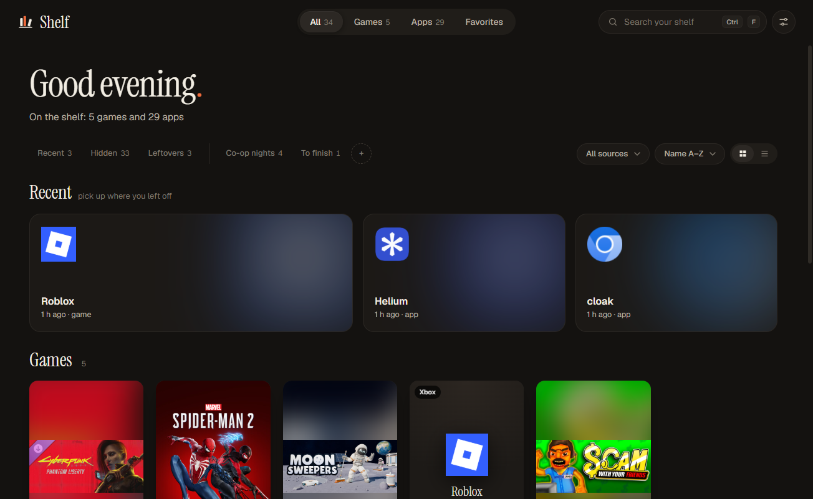
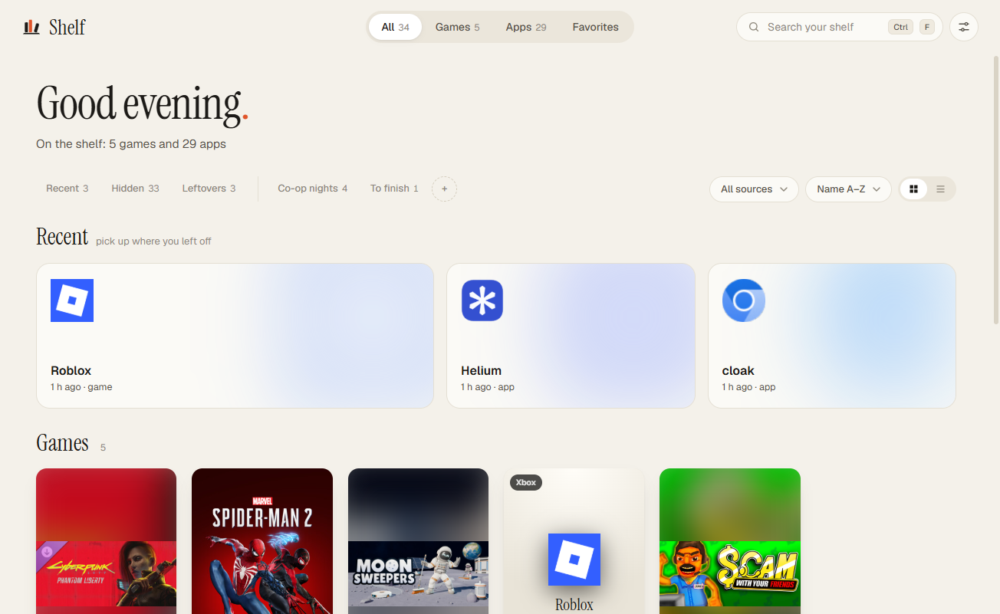
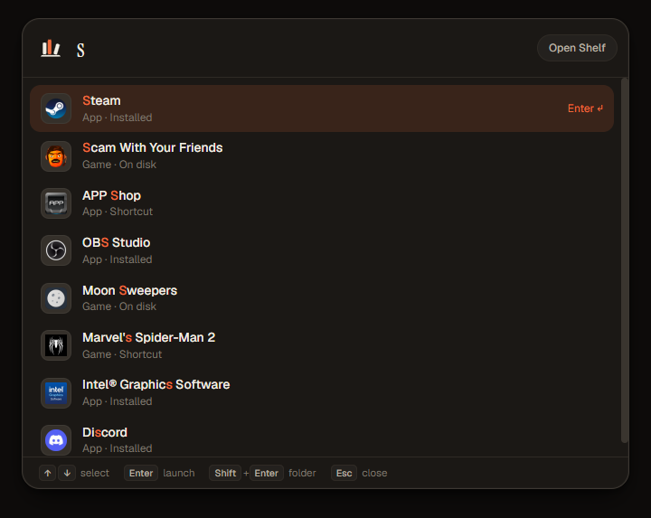
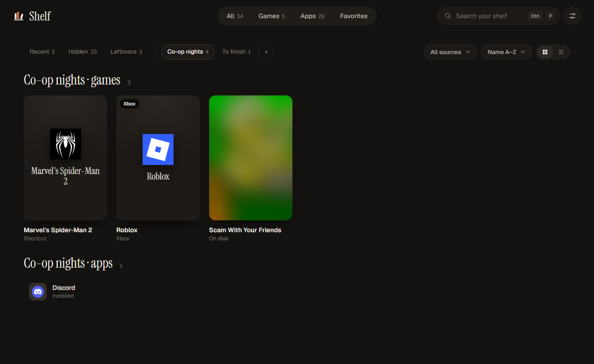

<div align="center">


# Shelf

**Everything you own, on one shelf.**

Shelf finds every game and app installed on your Windows PC – across Steam, Epic, GOG, Ubisoft, Xbox, the Microsoft Store and plain folders on any drive – and puts them in one calm, fast library you can launch from.

[](https://github.com/c0demite/Shelf/releases/latest)
[](https://github.com/c0demite/Shelf/releases)
[](#install)
[](https://www.electronjs.org/)
[](LICENSE)

[**Download**](https://github.com/c0demite/Shelf/releases/latest) · [Features](#features) · [Shortcuts](#keyboard-shortcuts) · [Build from source](#build-from-source) · [Contributing](#contributing)

<br>



</div>

---

## Why

After a few years every PC turns into an attic. Games live in four different launchers, apps hide in `Program Files`, a portable tool sits on drive `D:` and you forget you ever installed half of it. Shelf scans all of it in about two seconds and gives you one place to see, search and start everything you own – plus a <kbd>Ctrl</kbd>+<kbd>Space</kbd> launcher that works from anywhere.

## Features

- **Finds everything, on every drive.** The Windows registry, Steam (every library, even games Steam no longer sees), Epic Games, GOG, Ubisoft Connect, Xbox / Game Pass, Microsoft Store apps, Start menu and desktop shortcuts, and a light scan of folders on all drives. Developer projects are skipped.
- **Games and apps, sorted for you.** Shelf tells games from apps on its own. If it gets one wrong, fix it with a right-click.
- **Real cover art.** Tall covers from the Steam store, also for games you didn't buy on Steam. Apps get their real, sharp Windows icons.
- **Quick launcher.** Press <kbd>Ctrl</kbd>+<kbd>Space</kbd> anywhere, type two letters, hit <kbd>Enter</kbd>. Initials work too: `ms` finds *Marvel's Spider-Man*.
- **Your own shelves.** Group anything into collections such as *Co-op nights* or *To finish*.
- **Playtime for every game.** Shelf notices when a game is running, however you started it, and counts the hours – not only for Steam.
- **Recently played, favorites, hidden.** Pick up where you left off, star what matters, hide what doesn't.
- **Leftovers.** Finds empty folders and dead registry entries left behind by uninstalled games.
- **Dark and light theme**, or follow Windows.
- **English and Polish.** Adding a language is a single file – see [Translations](#translations).
- **Lives in the tray.** Closing the window keeps Shelf in the tray so the shortcut keeps working; it can start with Windows.
- **Private by design.** No account, no telemetry, no ads. Your library never leaves your PC.

<div align="center">
<table>
  <tr>
    <td></td>
    <td></td>
  </tr>
  <tr>
    <td align="center"><sub>Light theme</sub></td>
    <td align="center"><sub>Quick launcher – <kbd>Ctrl</kbd>+<kbd>Space</kbd> from anywhere</sub></td>
  </tr>
  <tr>
    <td colspan="2"></td>
  </tr>
  <tr>
    <td colspan="2" align="center"><sub>Your own shelves</sub></td>
  </tr>
</table>
</div>

## Install

1. Download **`Shelf-Setup-x.y.z.exe`** from the [latest release](https://github.com/c0demite/Shelf/releases/latest).
2. Run it. Shelf installs for your user only – no admin rights needed.
3. The first scan starts right away and takes a few seconds.

> [!NOTE]
> The installer is not code-signed yet, so Windows SmartScreen may show *"Windows protected your PC"*. Click **More info → Run anyway**. You can always [build it yourself](#build-from-source) instead.

**Requirements:** Windows 10 or 11, 64-bit.

## Keyboard shortcuts

| Where | Shortcut | Action |
| --- | --- | --- |
| Anywhere | <kbd>Ctrl</kbd>+<kbd>Space</kbd> | Open the quick launcher (falls back to <kbd>Ctrl</kbd>+<kbd>Alt</kbd>+<kbd>Space</kbd> if taken) |
| Quick launcher | <kbd>↑</kbd> <kbd>↓</kbd> / <kbd>Enter</kbd> | Pick / launch |
| Quick launcher | <kbd>Shift</kbd>+<kbd>Enter</kbd> | Open the install folder |
| Library | just start typing, or <kbd>Ctrl</kbd>+<kbd>F</kbd> / <kbd>/</kbd> | Search |
| Library | <kbd>Enter</kbd> | Launch the focused tile |
| Library | right-click, or <kbd>Shift</kbd>+<kbd>F10</kbd> | Favorite, shelves, game/app, hide, open folder, uninstall |
| Everywhere | <kbd>Esc</kbd> | Clear search / close |

## Privacy

Shelf works offline. The only thing it ever sends over the network is a **game title to the public Steam store search**, to find cover art. That request carries no account, no ID and nothing about your PC. Everything else – your library, favorites, shelves and playtime – stays in `%APPDATA%\Shelf\state.json`.

## Build from source

You need [Node.js](https://nodejs.org/) 20 or newer and Windows.

```bash
git clone https://github.com/c0demite/Shelf.git
cd Shelf
npm install
npm start          # run in development
npm run dist       # build the installer into dist/
```

Double-clicking `Shelf.vbs` starts a source checkout without a console window.

Useful flags while developing:

| Flag | What it does |
| --- | --- |
| `--dump out.json [--covers]` | Scan headlessly and write the raw results |
| `--screenshot out.png [--wait ms] [--click "css,css"] [--quick] [--query text] [--lang pl] [--theme light]` | Render a window to a PNG (uses a separate debug profile) |
| `--hidden` | Start in the tray (used by *Start with Windows*) |

### Project layout

```
main.js            Electron main process: state, scanning, covers, launching, tray, shortcut, playtime
preload.js         The small, typed bridge the windows are allowed to use
src/scanner.js     Finds games and apps (registry, launchers, shortcuts, folders)
src/icons.js       Pulls high-quality icons through the Windows shell
src/util.js        Matching, cleanup and a tiny VDF parser for Steam files
renderer/          The library window, the quick launcher, styles, themes and translations
```

## Translations

All text lives in [`renderer/i18n.js`](renderer/i18n.js). To add a language, copy the `en` block, translate the strings, and add your language to `LANGS` at the bottom of the file. Pull requests with new languages are very welcome.

## Roadmap

- [ ] Signed installer and automatic updates
- [ ] Heroic, itch.io, Battle.net and EA app libraries
- [ ] Manually add a game or app that Shelf didn't find
- [ ] Custom cover art
- [ ] More languages

Ideas and bug reports go to [Issues](https://github.com/c0demite/Shelf/issues).

## Contributing

Contributions of any size are welcome – a bug report, a translation, a new launcher or a design tweak.

1. Fork the repo and create a branch: `git checkout -b my-change`
2. `npm install && npm start`, make your change, and check it in both themes and both languages
3. Open a pull request with a short description and, for anything visual, a screenshot

If Shelf misses or misclassifies something on your PC, an issue with the app name and its install path helps the most.

## License

Shelf is released under the [MIT License](LICENSE).

It bundles the [Geist](https://github.com/vercel/geist-font) and [Instrument Serif](https://github.com/Instrument/instrument-serif) fonts under the [SIL Open Font License 1.1](renderer/fonts/OFL.txt). Game cover art is loaded from the Steam store and belongs to its respective owners. Shelf is not affiliated with Valve, Epic Games, CD PROJEKT, Ubisoft, Microsoft or any other platform it reads from.

<div align="center">
<sub>Made with care by <a href="https://github.com/c0demite">c0demite</a>.</sub>
</div>
